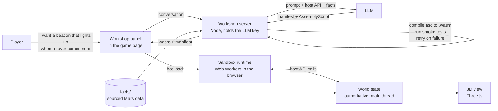
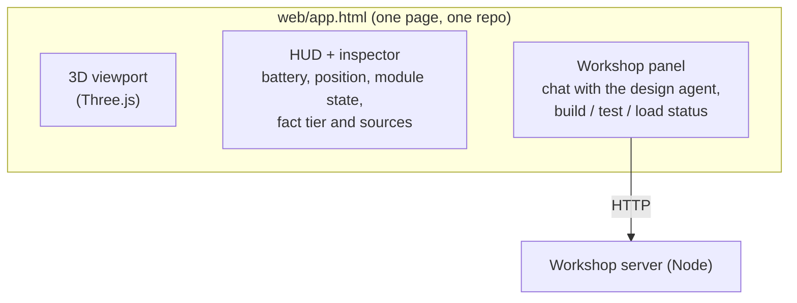
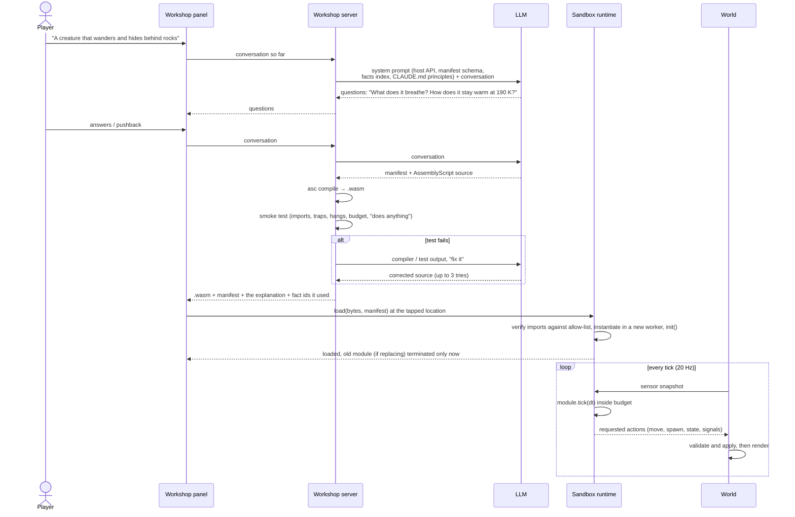
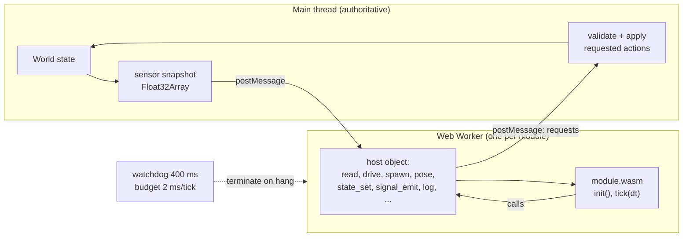
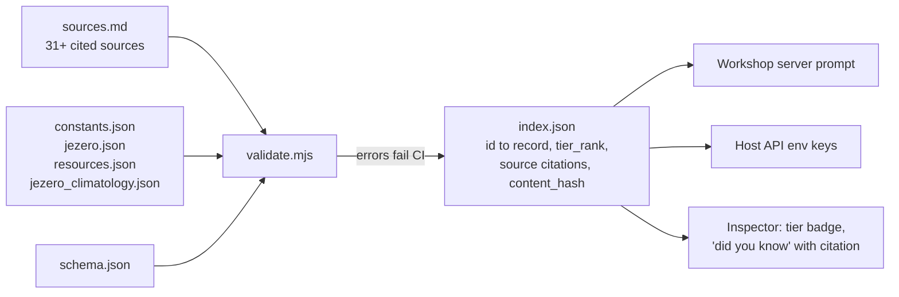
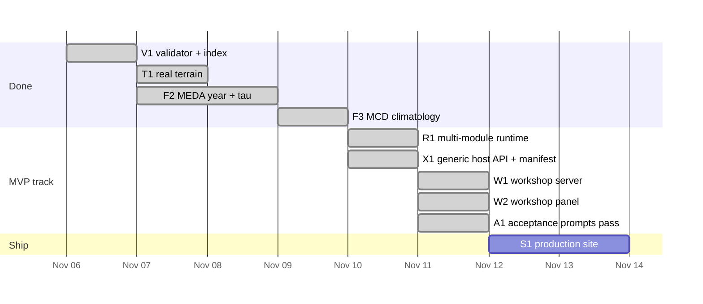
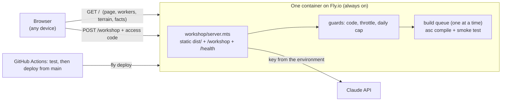

# Mars Sandbox developer guide

A map of the system for people, not for the coding agent. It answers: what are
the pieces, where does each one run, how do they talk, and what is the stack.
Diagrams are Mermaid; GitHub renders them. Definitions are in the glossary at
the end, and every term in **bold** on first use is defined there.

If you read one section, read "The one picture".

---

## 1. The one picture

A player describes something. An LLM turns it into a small program. The program
is compiled, tested, and loaded into the running world without a reload. The
world keeps it inside a sandbox where it can only touch what we allow.



Three things to hold onto:

1. **The world is the only authority.** Modules never change it directly; they
   *request* actions through the **host API**, and the world decides.
2. **The LLM proposes, it does not run.** It writes a module once. After that the
   module runs on its own, inside a worker, with a CPU budget and a watchdog.
3. **Facts come from files, not from the model's memory.** The LLM and the engine
   both read `facts/`. Nothing about Mars is invented at runtime.

---

## 2. The components

| Component | What it is | Where it runs | Exists today? |
|---|---|---|---|
| **Game client** | The web page: 3D Mars, HUD, inspector, workshop panel | Player's browser | Yes (`web/app.html` + `web/workshop.mjs`, W2) |
| **World state** | Positions, energy, time, every object and its module; applies requested actions, runs physics | Browser main thread today; a server process later for multiplayer | Yes, single-player |
| **Sandbox runtime** | Loads `.wasm` modules into Web Workers, verifies their imports, feeds them sensor snapshots, collects their requests, enforces budget and watchdog | Browser, one worker per module | Yes, many: `runtime/registry.mjs` (R1); the rover is the first registry entry |
| **Host API** | The fixed list of functions a module may call: read environment, request movement, spawn shapes, set state, emit signals | Defined in `behaviors/host.ts`, implemented in the runtime, documented in `docs/HOST_API.md` | Yes: rover calls plus the generic calls (X1) |
| **Module** | A compiled Wasm program the player (via the LLM) created: a behavior, a device, a creature, a structure | Inside one worker | Yes, four hand-written samples |
| **Manifest** | JSON beside each module: name, description, declared state slots, declared signals, author, version, fact ids | Stored with the module; schema in `runtime/manifest.schema.json` | Yes (X1); the inspector in the page renders it (W2) |
| **Workshop server** | Small HTTP service: holds the LLM key, builds the prompt from the host API and `facts/index.json`, calls the LLM, compiles AssemblyScript to Wasm with `asc`, runs the smoke tests, returns the artifact; in production it also serves the page and stands behind an access code and a daily cap | A Node process: on the laptop locally; one always-on container on Fly.io in production (§11) | Yes (W1): `workshop/`, `npm run workshop`; S1 adds `Dockerfile`, `fly.toml`; `generate.py` is the older CLI version |
| **Facts layer** | Sourced, tiered Mars data: `facts/*.json` validated into `facts/index.json` | Build-time; the index ships with the client and the server | Yes |
| **Terrain** | Real Jezero elevation: MOLA context + HiRISE 1 m playable region | Built by `terrain/*.py`, shipped as 16-bit PNG | Yes |
| **Persistence** | Saving and restoring worlds, versions, sharing | Postgres + object storage | Later |
| **Multiplayer room** | One process per shared world, WebSocket fan-out | Server | Later |

---

## 3. "Is the workshop a different UI than the game?"

No. It is a panel inside the same page, next to the 3D view, in the same repo.



Why one page: the player has to see the thing appear where they tapped, watch it
get tested, and inspect it afterwards. Splitting the workshop into another app
would turn the best moment of the game into a tab switch.

Why one repo: the server and the client share three things that must never
drift: the host API declaration (`behaviors/host.ts`), the manifest format, and
`facts/index.json`. A monorepo keeps one commit = one consistent version.

The one piece that is physically separate is the **workshop server**, because
the LLM key must never reach the browser. During development it is a Node
process on the laptop (`npm run workshop`), and the page talks to
`localhost`. In production the same process runs in one container with the
key in the host's environment, and it serves the page too, so the page talks
to its own origin (§11).

---

## 4. What happens when a player creates something



The "questions" step is where CLAUDE.md lives. The model has the facts in its
prompt, so when a player asks for a fish-shaped alien it can ask what a fish
shape buys you where there is no surface water. We don't code those questions;
we give the model the facts and the principle and let it ask.

---

## 5. How a module runs



What the sandbox guarantees, today, with tests:

- A module can only import functions on the allow-list. Anything else is rejected
  before it is instantiated.
- It sees a *copy* of the sensors, never the world.
- Its actions are requests; the main thread clamps and applies them.
- Over budget three ticks in a row: disabled. Hangs: worker terminated. The world
  never pauses either way.
- 64 floats of host-owned memory survive a module reload, so "v2" can inherit v1's
  state.
- Two environment sensors, `ENV_AIR_TEMP_K` (key 14) and `ENV_LOCAL_HOUR` (key 15),
  come from `runtime/clock.mjs`, the one clock the page's sun and every module
  share; the temperature is the measured MY36 hourly curve read at the local hour
  (L1), typical for the hour, not today's weather.

The MVP adds no new guarantees; it adds generic calls (`spawn`, `pose`,
`state_set`, `signal_emit`, `terrain_height`, `nearest`) so a module can be
anything, and makes the runtime hold many modules at once.

---

## 6. The facts layer, in one diagram



Every number has a `tier`: `defined > measured > derived > engineering > modeled
> hypothesis`. A thing built from several facts shows the weakest tier it rests
on. Player assumptions ("my aliens breathe CO2") live in the world, never in
`facts/`, and show as "assumed".

---

## 7. Repo layout

```
mars-sandbox/                  one repo, one version
├── CLAUDE.md                  intent and conventions (read first)
├── docs/DEV_GUIDE.md          this file
├── facts/                     sourced Mars data + validator + agent brief
│   ├── *.json  schema.json  sources.md  hypotheses.md  AGENT_BRIEF.md
│   ├── validate.mjs  index.json (generated)
│   └── derive/                scripts that produced measured records (MEDA, MCD)
├── terrain/                   MOLA + HiRISE ingestion → web/terrain/*.png
├── behaviors/                 host.ts (the host API) + sample modules (.ts)
├── build/                     compiled .wasm (generated)
├── web/                       the game page: app.html, png16.mjs, terrain/
├── test/                      validator, terrain, rover and smoke tests
├── generate.py                older CLI prompt → module loop (superseded by workshop/)
└── (MVP adds)
    ├── runtime/               multi-module sandbox runtime, manifest loader, clock.mjs (world clock + diurnal lookup)
    ├── workshop/              Node (TypeScript) server: prompt from the shared files, Claude API, asc compile, smoke test, retry (W1)
    │   ├── guard.mts          access code, throttle on wrong codes, daily cap on model calls (S1)
    │   ├── static.mts         serves dist/ with the Content-Security-Policy and the other headers (S1)
    │   └── acceptance/        the A1 runner (npm run acceptance) and the recorded transcripts
    ├── Dockerfile, fly.toml   the production container and the Fly.io app (S1); scripts/deploy_check.mjs checks a deployed site
    ├── test/acceptance/       the offline behaviour checks and judge for the five acceptance objects (node test/acceptance/judge.mjs)
    └── web/workshop.mjs       the workshop panel + inspector (W2), bundled by pack.mjs
```

---

## 8. Stack, and why

| Layer | Choice | Why | Deferred |
|---|---|---|---|
| 3D | Three.js, plain TypeScript/JS modules | Already working; small; no framework needed for one page | React, if the UI grows past the workshop panel |
| Module language | AssemblyScript → WebAssembly | TypeScript-like syntax the LLM writes well; compiles in ~1 s; tiny binaries (250 B to 3 KB) | Rust for heavier physics modules |
| Sandbox | Web Workers + Wasm import allow-list | Real isolation in the browser with nothing to install | Server-side Wasmtime when the world moves to a server |
| Workshop server | Node (TypeScript) | Same language as the runtime; `asc` is an npm package; runs locally and on Vercel unchanged | Python FastAPI was in the spec; dropped to avoid two toolchains |
| LLM | Anthropic API via the server | Structured output, long context for host API + facts | Provider abstraction if we want to compare models |
| Facts | JSON + JSON Schema + Node validator in CI | Reviewable in a PR; diffable; no database needed yet | |
| Data processing | Python (numpy, Pillow, tifffile) | PDS archives are easiest from Python | |
| Hosting | One container (`Dockerfile`) on Fly.io: the packed client and the workshop server in one process, always on | A serverless function cannot hold a request that waits minutes for the model, runs the compiler and the smoke test in child processes and keeps one build queue and one daily counter per deployment (§11) | A CDN for the client if it ever needs one (`WORKSHOP_URL` already supports a separate host); per-room servers later |
| Persistence | none yet (world lives in the page) | MVP does not need it | Postgres + S3-compatible storage |

What the MVP deliberately does **not** include: physics primitives, the
conservation audit, the greenhouse, persistence, multiplayer, accounts. Each
returns later as more host functions and stricter tests, without changing the
creation loop.

---

## 9. Running it locally

```
npm install                      # asc, three, ajv
npm run facts                    # validate facts, write facts/index.json
./build.sh                       # compile behaviors/*.ts → build/*.wasm
npm test                         # validator + terrain + rover + smoke tests
node pack.mjs                    # bundle → dist/index.html
python3 -m http.server -d dist 8000
```

MVP adds:

```
cp .env.example .env             # ANTHROPIC_API_KEY=...  (gitignored, never committed)
npm run workshop                 # Node server on :8787
npm run acceptance               # A1: the five prompts against the real model, transcripts under workshop/acceptance/
node test/acceptance/judge.mjs   # judge recorded transcripts offline (rebuild, smoke test, behaviour check)
```

---

## 10. Roadmap to the MVP



Acceptance for the MVP: five prompts the app has no concept of (weather
station, proximity beacon, sun-tracking panel, wandering creature, dust gauge)
each produce a working object from a cold start within two tries, with the
design agent asking at least one fact-grounded question along the way.

---

## 11. Deployment (S1)

One URL the owner can open from any device: a single container serves the
packed page and the workshop server, behind an access code and a daily cap on
model calls. The key never leaves the host's environment.



### Why one container and not a serverless function

The earlier plan (Vercel: static client plus a server function) does not fit
what the server does. One request can hold a model call of up to 10 minutes
(`workshop/llm.mts`: 600 s timeout, two SDK retries), then a compile in a
limited worker thread and the smoke test in a child process, up to three
tries, with builds serialised through one queue because the smoke test times
ticks on the wall clock (a build sharing the CPU measured 4 to 28 ms for a
module that takes 0.5 ms alone; `workshop/compile.mts`). Vercel's documented
maximum function duration at the time of writing (300 s on the Hobby plan,
800 s on Pro with Fluid Compute) is below one request's own timeout; function
instances scale out, so the queue and the daily counter would be per
instance, not per deployment; and the CPU is shared, which is exactly the
noise the 2 ms budget was measured to be sensitive to. Weakening the smoke
test or the budget to fit a host is ruled out by the sandbox guarantees.

The smallest thing that fits is one always-on container with the whole
repo's toolchain in it, so that is what `Dockerfile` and `fly.toml` build:
Fly.io, one shared-CPU machine with 2 GB (a hostile source can take the
compiler to several GB before its 20 s limit; at 2 GB the kernel ends that
process and the machine restarts instead of thrashing). Any host that runs a
Dockerfile with environment variables works the same way (Render, Railway).
The client is served by the same process so the page talks to its own origin:
no CORS, a `connect-src 'self'` policy, one host to protect. `WORKSHOP_URL`
exists for the day the page is hosted apart (a CDN): `node pack.mjs` writes it
into the page and the server adds it to the page's `connect-src`.

### What stands in front of the workshop

Checked in this order, before the body is read or the model called:

1. **Host and Origin** must be exactly the deployed host and origin
   (`WORKSHOP_HOSTS`, `WORKSHOP_ORIGINS`); local pages are always allowed, as
   before. Body limit 1 MB, JSON only.
2. **Access code** (`WORKSHOP_ACCESS_CODE`): the page sends it as a bearer
   token; the server compares sha256 digests in constant time. Without it:
   401 and the page asks the player for the code once, keeping it on the
   device (`localStorage`, per workshop URL), never in the conversation. Five
   wrong codes from one address in ten minutes: 429 for the rest of the window
   whatever the code. Behind Fly's proxy the address comes from
   `X-Forwarded-For` (`WORKSHOP_TRUST_PROXY=1`).
3. **Daily cap** (`WORKSHOP_DAILY_CAP`, default 50 model calls per UTC day,
   retries inside one request included): past it the server answers 429
   `closed` and the page shows "the workshop is closed for today" with when it
   reopens, as a next step; the samples still load and built objects keep
   running. The count lives in the process: a restart or a deploy starts the
   day over, which is why the default is conservative.
4. `/health` says `{ ok: true }` to any caller on the served host (the
   host's health check sends that Host header; `fly.toml`) and its details
   only with the code.

Without an access code the server refuses to listen on anything but a
loopback address, so a container cannot be started open by mistake.

The page's headers (`workshop/static.mts`): a Content-Security-Policy that
allows scripts only from the page's own origin, the two inline blocks by hash
(the import map and the module script), three.js from the one CDN the import
map names, and `'wasm-unsafe-eval'` so the sandbox worker can instantiate a
module; `worker-src 'self'`; `connect-src 'self'` (plus `WORKSHOP_URL`);
styles by hash; no inline event handlers; `X-Content-Type-Options: nosniff`;
`Referrer-Policy: no-referrer`. Every file carries the policy, the worker
script included. The sandbox guarantees (import allow-list, worker isolation,
budget, watchdog, memory and table policy) are unchanged.

A proxy may close a response that stays silent for minutes, so in production
the server writes one space every `WORKSHOP_KEEPALIVE_S` seconds while a
request waits for the model (JSON allows leading whitespace); an outcome that
would have been another status travels in the body as `{ type: "error",
status }` and the page reads it the same way. Local servers send plain
responses.

### Environment variables

| Name | Where | What |
|---|---|---|
| `ANTHROPIC_API_KEY` | secret | The model key. Read by the server only; never in the repo, the image, the page or a log. |
| `WORKSHOP_ACCESS_CODE` | secret | The shared code players type once. Required before `WORKSHOP_BIND` can be anything but loopback. |
| `WORKSHOP_DAILY_CAP` | secret or env | Model calls per UTC day (default 50). |
| `WORKSHOP_HOSTS` / `WORKSHOP_ORIGINS` | `fly.toml` | Exactly the deployed host and origin (`<app>.fly.dev`, `https://<app>.fly.dev`). |
| `WORKSHOP_BIND` / `WORKSHOP_PORT` | `fly.toml` | `0.0.0.0` / `8787` in the container; `127.0.0.1` locally. |
| `WORKSHOP_STATIC` | `fly.toml` | `dist`: serve the packed page from the same process. |
| `WORKSHOP_KEEPALIVE_S` | `fly.toml` | `20` in production; unset locally. |
| `WORKSHOP_TRUST_PROXY` | `fly.toml` | `1` behind Fly's proxy. |
| `WORKSHOP_MODEL` | optional | The model (default `claude-opus-5-5`). |
| `WORKSHOP_URL` | optional | Only when the page is hosted apart from the server. |
| `FLY_API_TOKEN` | GitHub secret | Lets CI deploy. Nothing deploys until it exists. |
| `WORKSHOP_URL` (repository variable) | GitHub variable | The deployed URL; CI runs `scripts/deploy_check.mjs` against it after a deploy. |

### Deploying, rotating, going offline

Setting up (the owner, once): create the Fly app (`fly launch --no-deploy`
from the repo, or set `app` in `fly.toml` to an existing app), set the two
host values in `fly.toml` to the app's host, then

```
fly secrets set ANTHROPIC_API_KEY=... WORKSHOP_ACCESS_CODE=... WORKSHOP_DAILY_CAP=50
```

Deploying: every push to `main` runs the test job; the deploy job runs after
it and only if it passed, and only when `FLY_API_TOKEN` is in the repository
secrets. No branch deploys. By hand, `fly deploy` from the repo does the
same thing (it uses the same `Dockerfile`). Afterwards
`node scripts/deploy_check.mjs https://<app>.fly.dev` checks, with no key and
no code, that the page loads with its headers, `/health` says only ok, and
`/workshop` without the code is refused; CI runs it when the `WORKSHOP_URL`
repository variable is set.

Rotating the key: `fly secrets set ANTHROPIC_API_KEY=...` (the machine
restarts with the new value); then revoke the old key in the Anthropic
console. Rotating the access code: `fly secrets set WORKSHOP_ACCESS_CODE=...`;
every player is asked for the new code on their next message (a kept code the
server refuses is forgotten by the page).

Taking the workshop offline quickly: `fly scale count 0` stops the machine
(the URL stops answering); `fly secrets unset ANTHROPIC_API_KEY` makes the
server refuse to start (the page stays up until the next restart, the
workshop answers with an error); `fly secrets set WORKSHOP_DAILY_CAP=1` leaves
the page up with the workshop closing after one call. Back: the reverse.

### Measured

Locally (the acceptance runs of A1, `claude-opus-5-5`): the question turn 16
to 19 s; the build turn 59 to 131 s including the player's typing and one or
two tries; compile plus smoke test of the weather station 400 to 510 ms. The
worst case the code allows is far longer (a 600 s model timeout with two SDK
retries, three tries), which is what rules out a function with a duration
limit. Durations on the host itself are not measured until the owner's app
exists; the first numbers to record there are a question turn and a build turn
through the proxy with the keepalive on.

---

## Glossary

**World / world state.** Everything that is true in a player's Mars: objects,
positions, energy, time, signals. Owned by the main thread today, by a room
server later. The only thing allowed to change it is itself.

**Object.** A thing in the world with a position: the rover, a beacon, a
creature. Most objects have a module; some (rocks, the charger) do not.

**Module.** A compiled WebAssembly program attached to an object that decides
what the object does each tick. Created by the LLM from a player's description.
Earlier docs call these "behaviors"; a behavior is a module that only drives.

**Manifest.** The JSON description that travels with a module: name, what state
it exposes, what signals it emits or listens for, who made it, version, and the
fact ids it depends on. The inspector renders from this, so it can show objects
it has never seen.

**Host API.** The complete list of functions a module can call. Declared once in
`behaviors/host.ts`; implemented by the runtime. If it isn't in the host API, a
module cannot do it. Growing this list is how the game gains capabilities.

**Sandbox runtime.** The code that loads modules into Web Workers, checks their
imports, feeds them sensor snapshots, collects their requests, enforces the
budget and watchdog, and swaps modules without pausing the world.

**Web Worker.** A browser thread with no access to the page. Our isolation
boundary: a hung or hostile module can be terminated from outside.

**WebAssembly (Wasm).** A portable binary format the browser runs at near-native
speed. A Wasm module can only call functions the host hands it at load time,
which is why it is the right container for untrusted player code.

**AssemblyScript.** A TypeScript-like language that compiles directly to Wasm.
What the LLM writes.

**Smoke test.** The automatic check a freshly compiled module must pass before a
player sees it: legal imports only, exports `init` and `tick`, no trap, no hang,
under the tick budget, actually does something.

**Hot-load.** Loading or replacing a module while the world keeps running. The
new module is built beside the old one and swapped in only after its `init()`
succeeds.

**Workshop.** The panel where a player and the design agent create something
together, and the server behind it.

**Design agent.** The LLM, with the host API, manifest schema, facts index and
CLAUDE.md principles in its prompt. It asks, proposes, cites and writes the
module. It never runs anything and never invents a Mars number.

**Facts layer.** `facts/`: sourced, tiered Mars data with a validator that fails
the build on an unsourced number. The index is read by the server (for the
prompt), the runtime (for environment values) and the inspector (for citations).

**Tier.** How well we know a fact: `defined`, `measured`, `derived`,
`engineering`, `modeled`, `hypothesis`. A design shows the weakest tier it
rests on. Player choices are a separate label, `assumption`.

**Signal.** A named number a module publishes through the host that other
modules can read. How a player's beacon notices another player's rover without
either knowing the other's code.

**Primitives (later).** Vetted physics functions (conduction, radiation, PV
output, crop growth) with tests and citations, which generated modules compose
instead of re-deriving physics. Not in the MVP.

**Conservation audit (later).** The engine's per-tick check that energy and mass
balance across all components; the main defence against a plausible but wrong
generated model. Not in the MVP.

**Room (later).** One server process per shared world, holding the authoritative
state for several players. Single-player is the one-collaborator case.
